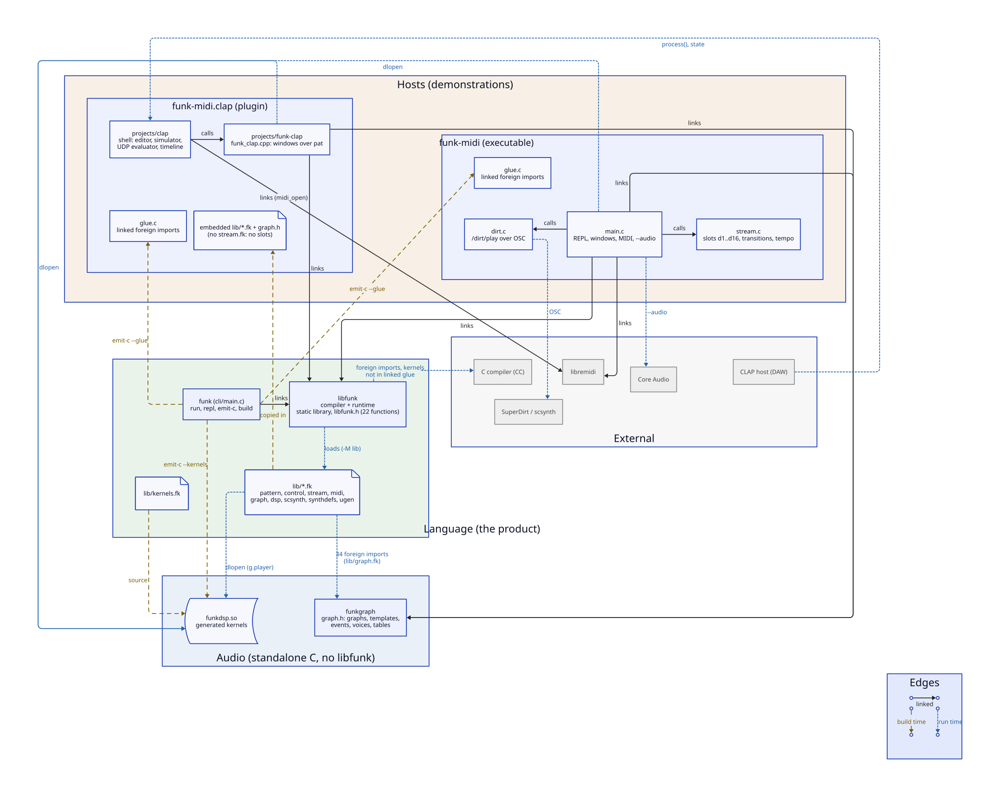

# Current status against the roadmap

Status on 2026-11-23, against [roadmap.md](roadmap.md). The last release is 0.13.0, 2026-11-19. Milestones 0.1 to 0.13 are done. No milestone after 0.13 is set.

## Milestones

| Milestone | Status | Evidence |
|-|-|-|
| 0.1 to 0.9 | Done | Releases 0.1 to 0.9.0, to 2026-11-01 |
| 0.10 Stabilization | Done | A REAPER set of 48 steps over 6.4 min, no block over budget |
| 0.11 Tidal expressive patterns | Done, but the conditional language items | The 22 patches of [patch-port.md](patch-port.md) match Tidal 1.10.2's events |
| 0.12 Tidal parity: code and runtime | Acceptance passed 2026-11-11, in release 0.11.0 | All 6456 events match (`lib/tidal-patches`); T3, R6, L7 and `showAll` moved to 0.13 |
| 0.13 SuperDirt sound in the plugin | Released in 0.13.0 | The four criteria below |
| 0.14+ language growth | Not started | Each item needs a design note first |

0.13's criteria ([dirt-acceptance.md](dirt-acceptance.md)):

| Criterion | Result |
|-|-|
| Sound | 3,095 events in 18 patches match scsynth with error 0, against a bound of 1e-6 |
| Real time | `hosts/clap/sim-dirt` and its `noalloc` variant pass. The budget test depends on machine load: on 2026-11-22 a block took 15.1 ms of its 10.7 ms budget |
| Cost | funk's render CPU is 1.05x to 4.6x scsynth's. Accepted; faster generated kernels follow 0.13 |
| By ear | REAPER on macOS, 2026-11-19. The Linux run follows the release |

## Open from 0.11 to 0.13

- Moved from 0.12: T3 (`Rational` times), R6 (Ableton Link, editor integration), the L7 decision, and F5's `showAll`.

- C3's buses, which wait for S2, and `ringCount` for a name.

- `Floating` on patterns, not yet a numbered gap in [tidal-comparison.md](tidal-comparison.md).

- 0.11's conditional language features: `type` synonyms, as-patterns, higher-kinded classes.

- The oracle environment ([TODO.md](../../TODO.md), "Test environment"):
  - SuperCollider 3.14.1 fails the oracles, `plain` by 0.116;

  - on Linux, `shape`, `imp` and `impAccelerate` miss the bound;

  - a develop SuperDirt breaks `render.scd`;

  - without sclang, `make test` passes with the oracles unregistered.

- The REPL: `:l` of a file a second time rejects its classes and instances; a signature and its definition need `:{ :}`.

## Since 0.13.0

Unreleased work is from a review of the compiler and runtime ([261122-review.md](261122-review.md)), not from the roadmap: 2 Changed entries and 14 Fixed entries in [CHANGELOG.md](../../CHANGELOG.md).

## Components

### How they relate

[components.svg](../media/components.svg), [components.pdf](../media/components.pdf), from [components.d2](../media/components.d2) by `make diagrams`. Black edges link, brown dashed ones run at build time, blue dotted ones at run time.

1. **The `funk` tool builds the other parts.** `emit-c --kernels` makes `funkdsp.so` from `lib/kernels.fk`, and `emit-c --glue` makes each host's `glue.c`. No host or audio build runs without it.

2. **funkgraph is beside libfunk, not under it.** It links Threads alone and includes nothing of libfunk's. funk code reaches it through 34 foreign imports in `lib/graph.fk`; the hosts and `g.player` `dlopen` `funkdsp.so` and hand funkgraph its kernels. funkgraph never calls funk, so it could ship as its own package.

3. **The hosts' contract is `lib/*.fk` more than `libfunk.h`.** They use `funk_eval`, `funk_call` with `Int` arguments, and output. They build funk source as strings, compile it with `funk_eval`, then call it each window with `funk_call`; pointers cross as `Int`, written `plusPtr nullPtr buf` (`funk_clap.cpp:80`). The rest goes through `pattern`, `control`, `stream`, `graph` and `dsp`, which are api in effect, though not documented as such.

4. **Each host repeats one layer.**

   | Piece | funk-live | plugin |
   |-|-|-|
   | Window loop over patterns | `main.c` | `funk_clap.cpp` |
   | Slot table | funkgraph's `stream.c`, shared | the same, one per instance |
   | Slots' clock and window | `main.c` | `funk_clap.cpp` |
   | `lib/*.fk` | read from disk, `-M lib` | 9 modules embedded |
   | `funkdsp.so` | `dlopen` in `main.c` | `dlopen` in `funk_clap.cpp` |
   | Linked glue | its own `glue.c` | its own `glue.c` |
   | SuperDirt | external, OSC (`dirt.c`) | internal sound, through funkgraph |

   The slot table is shared since 2026-11-24. Each host still has its own window loop and clock functions.

5. **libfunk's one run-time dependency outside the process is the C compiler**, for foreign imports not in linked glue and for live kernels.

`projects/clap` is the plugin shell: its editor, simulator, UDP evaluator and timeline. `projects/funk-clap` binds it to funk.

### libfunk

What it has:

- 23 functions in `libfunk.h`.

- Sessions, up to 256 per process.

- Linked glue, so a host needs no C compiler for its own foreign imports.

- An install target with a CMake package.

- 17 C tests in `tests/embed`.

Gaps:

1. **No stability promise.** `libfunk.h` says "Internal: no stability promise between releases". The api is what the two hosts needed. No host outside this repository is known to use it.

2. **`funk_call` takes and returns `Int`s only, 1 to 8 of them.** A host passes floats, strings and buffers through pointers cast to `Int`, and writes a funk wrapper for each entry point.

3. **Errors are text.** They reach the host as `funk_output` stream 2, with no location or code to act on. An editor or a language server would parse the text.

4. **Each `funk_eval` input keeps its compiled code.** An input leaves 28 KB of compiler memory (CHANGELOG, Unreleased), so a long session grows without bound (TODO, friction #6).

5. **A C compiler at run time** for foreign imports that are not in linked glue, and for kernels. Under the hardened runtime, a relative `XDG_CACHE_HOME` fails every kernel load (TODO).

6. **Glue shared by path** binds the last session's `funk_provide` addresses (TODO, Sessions). Phase 1, several instances in one runtime, is deferred ([embedding.md](embedding.md)).

7. **Open review items:** C13, a race on stack pages written from another thread ([261122-review.md](261122-review.md)).

8. **No guide for embedders.** [embedding.md](embedding.md) is a design record.

9. **`lib/*.fk` has no stability promise either**, though the hosts depend on it more than on `libfunk.h`. `pattern` has no export list: all 673 of its names are unqualified in the hosts ([261122-review.md](261122-review.md) 5.6).

10. **funkgraph has no install target or package.** It needs nothing of libfunk, so it could ship alone; an outside host now cannot use the audio layer.

### funk-live (executable)

What it has:

- The reference host for Tidal code: slots `d1`..`d16`, transitions, tempo commands and state.

- MIDI out through libremidi, SuperDirt over OSC (`--dirt`), and internal audio (`--audio`).

- Most of the host tests: `hosts/slots`, `transitions`, `tempo`, `state`, `dirt`, `events` and others, two of them under `FUNK_GCSTRESS`.

Gaps:

1. **One line per input** (`main.c:1003`). A `d1 $` with an indented `# gain` on the next line fails. The plugin reads paragraphs. [261122-review.md](261122-review.md) ranks this first for user access.

2. **No install target and no binary.** CMake installs `funk` and `libfunk` only. CI uploads the plugin, not funk-live.

3. **No `--watch FILE`** (R6), and no editor package that sends blocks.

4. **`--audio` lags the plugin.**
   - It cannot compile kernels while playing.
   - It estimates a note's frame from its clock.
   - Its Core Audio callback is outside the allocation test.
   - It has not been played on Linux.

5. **The slots' scheduling contract is unwritten** (TODO, "From rustel"): generations, unique onset ids, a stop that does not wait behind evaluation, expiry.

### funk-live.clap (plugin)

What it has:

- Paragraph evaluation, an editor with syntax colours, and the host's tempo.

- Kernels compiled while playing.

- `dirt` with SuperDirt's sound.

- Any number of instances.

- A simulator mode and a headless host.

- A test that `process()` does not allocate, free or lock.

Gaps:

1. **Slots, done 2026-11-24.** `d1 $` runs as in funk-live, but the DAW keeps the tempo: `setcps` and an event's `cps` do nothing ([stream.md](stream.md#in-the-plugin)).

2. **C6, done 2026-11-23: saved project state could turn the UDP evaluator back on.** It binds 127.0.0.1, but any local process can then evaluate code in the DAW (`plugin.cpp:741`).

3. **The real-time margin depends on load.** The dense set passes on a quiet machine, and once took 15.1 ms of a 10.7 ms block. funk's render CPU is 1.05x to 4.6x scsynth's.

4. **Linux is unplayed.** The 0.10 and 0.13 runs in REAPER on Linux are open.

5. **A C compiler at run time** for user `foreign export` kernels. On macOS without the Command Line Tools, `/usr/bin/cc` asks to install them.

6. **A `pat` that fails while playing goes silent** until it is redefined, while a failed compile keeps the old one ([261122-review.md](261122-review.md) 2.3).

## Gaps in the plan

1. No next milestone. 0.14+ lists possible features, with no order and no acceptance test.

2. The direction changed on 2026-11-23: the product is the language, compiler, runtime and libfunk, and the plugin and funk-live demonstrate them. Milestones 0.11 to 0.13 were music milestones, and the roadmap has none for the product.

## Priorities

Recommended in order. Language and library work comes first, as the hosts consume it; host needs feed back into it.

1. **C6, in the plugin.** Done 2026-11-23: saved state restores UDP only when `FUNK_LIVE_CLAP_UDP_PORT` is set.

2. **Hosts read definitions from libfunk.** Done 2026-11-24: `funk_defined` replaces each host's scan of the input's text for `pat`, `sig`, `dirt` and `controls`.

3. **libfunk as the product:**
   - a documented subset of `libfunk.h`, and of `lib/*.fk`'s modules, with a stability promise and a version check;
   - an export list for `pattern`;
   - typed `funk_call` arguments, at least `Float` and pointers;
   - errors as records, with file, line and message;
   - a guide for embedders, checked by an example host outside the repository's own.

   The two hosts are the test of each change.

4. **One host layer for both hosts:** the slot table is shared, and the plugin has slots (R1), done 2026-11-24. Still per host: the window loop, the clock functions, kernel loading and how `lib/*.fk` is loaded. Write the scheduling contract and test its clauses there.

5. **funk-live for users:** multi-line input, then an install target with a lib path relative to the executable, then binaries from CI. These are the cheapest steps that let someone outside run funk.

6. **Then:** C13; `--watch`; the Linux runs; `--audio`'s live kernels. Render CPU against scsynth waits on faster generated kernels, already planned after 0.13.

Alternative framing: treat funk-live, not libfunk, as the product's api, a program that others drive over standard input or OSC. That would put item 5 first and make item 3 smaller. Against it: the plugin and other hosts embed, so they need libfunk either way.
